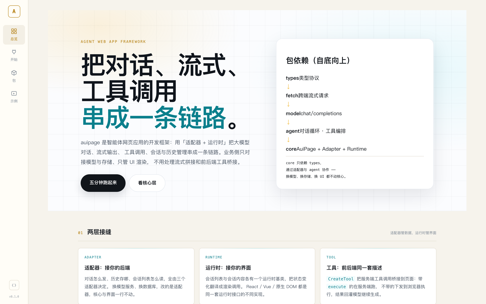

# [auipage](https://github.com/handless-ui/auipage)

> 智能体网页应用开发框架：用「适配器 + 运行时」把大模型对话、流式输出、工具调用、会话与历史管理串成一条链路。
> 业务侧只负责对接模型与存储、实现 UI 渲染，不用处理流式拼接和前后端工具桥接。

<p>
    <a href="https://github.com/handless-ui/auipage/issues"></a>
    <a href="https://github.com/handless-ui/auipage" target="_blank"></a>
    <a href="https://github.com/handless-ui/auipage"></a>
    <a href="https://gitee.com/handless-ui/auipage" target="_blank"></a>
    <a href="https://gitee.com/handless-ui/auipage"></a>
</p>



## 为什么需要它

搭一个智能体页面，真正麻烦的是这几件事：流式片段怎么拼、工具调用怎么在"服务端执行"和"浏览器执行"之间来回、
会话与历史怎么保持前后端一致。auipage 把它们拆成两层接缝，剩下的都是你的：

| 接缝 | 你要做的 | 框架要做的 |
| --- | --- | --- |
| **Adapter**（数据侧） | 实现对话、历史、会话列表三个适配器 | 在正确的时机调用它们，处理流式片段 |
| **Runtime**（界面侧） | 实现会话列表与对话内容的渲染钩子 | 把状态变化翻译成渲染调用，处理增量拼接 |

换模型服务只改适配器，换 UI 框架只改运行时，核心逻辑一份。

## 五个包

依赖自底向上：`types` ← `fetch` ← `model` ← `agent`；`core` 依赖 `types`，通过适配器与 `agent` 协作。

| 包 | 作用 |
| --- | --- |
| [`@auipage/types`](./packages/types) | 跨包共用的类型协议（模型配置、消息、工具、流式事件），零运行时代码 |
| [`@auipage/fetch`](./packages/fetch) | 跨端流式 fetch：浏览器 / Node 自动适配，内置 SSE 事件解析 |
| [`@auipage/model`](./packages/model) | OpenAI 风格 `chat/completions` 封装，支持流式与工具调用 |
| [`@auipage/agent`](./packages/agent) | 对话循环：工具调用编排、思维链回调、`CreateTool` 前后端桥接 |
| [`@auipage/core`](./packages/core) | 核心层：`AuiPage` + 三个 Adapter + 两个 Runtime |

## 跑起来

仓库根目录 [`src/`](./src) 就是一个可运行的最小示例：服务端接口、三个适配器、两套运行时、一对前后端工具对照。

```bash
pnpm i
npm run dev
# http://127.0.0.1:20000/
```

示例默认接本地 ollama（`qwen3.5`）；换成任意 OpenAI 协议服务只要改 `src/apis/chat.js` 里的 `baseURL` / `model` / `apiKey`。

## 用 React / Vue 的话

核心层之上的两套无头组件库，直接给出运行时实现：

- [@auipage/react](https://github.com/handless-ui/auipage-react) —— `ChatContent` + `ThreadList`，render-prop 渲染
- [@auipage/vue](https://github.com/handless-ui/auipage-vue) —— 同结构，作用域插槽渲染

## 版权

MIT License

Copyright (c) [zxl20070701](https://zxl20070701.github.io/notebook/home.html) 走一步，再走一步
