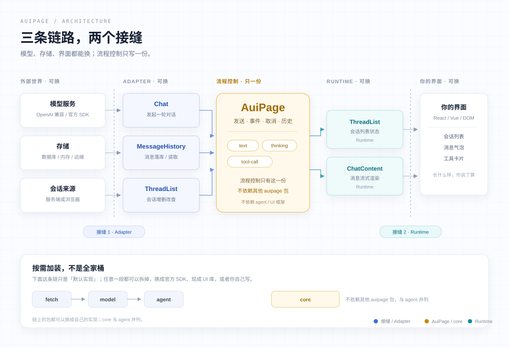
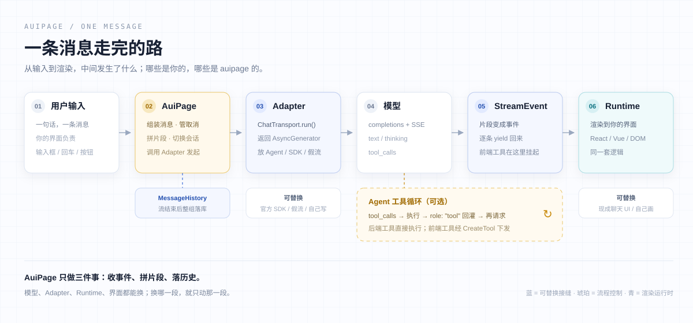

# [auipage](https://github.com/handless-ui/auipage)

> 智能体网页应用开发框架。不绑定模型，不绑定 UI 框架，只管中间那条链路。

<p>
    <a href="https://github.com/handless-ui/auipage/issues"></a>
    <a href="https://github.com/handless-ui/auipage" target="_blank"></a>
    <a href="https://github.com/handless-ui/auipage"></a>
    <a href="https://gitee.com/handless-ui/auipage" target="_blank"></a>
    <a href="https://gitee.com/handless-ui/auipage"></a>
</p>

**你负责模型和界面，auipage 负责中间那条链路。** 流式片段怎么拼、工具调用怎么在服务端和浏览器之间来回、会话与历史怎么保持前后端一致——这些脏活它接管，剩下的仍然是你的。

## 30 秒看效果

仓库根目录本身就是一个可运行的最小示例：一个真实模型、三个适配器、两套运行时、一对前后端工具。

```bash
pnpm i
npm run dev
# http://127.0.0.1:20000/
```

默认接本地 [ollama](https://ollama.com/) 的 `qwen3.5`；不想装 ollama 也能跑，改 `src/apis/chat.js` 里的 `baseURL` / `apiKey` / `model` 三行，接任意 OpenAI 兼容服务即可。

## 它替你省掉什么

| 你要做的事 | 没有框架时 | auipage 接管 |
| --- | --- | --- |
| 流式回复 | 自己切 SSE、处理跨包片段、把增量拼成一条消息 | `AuiPage` 收片段、拼文本、管理分段 |
| 工具调用 | 自己解析 `tool_calls`、执行、回灌模型、处理多轮循环 | `Agent` 跑完循环，前端工具经 `CreateTool` 桥接 |
| 会话与历史 | 自己维护 threadId、消息组、切会话、落库时机 | 三套 Adapter + 两个 Runtime 的固定接缝 |

## 四个包，可以只用其中一个

依赖自底向上：`fetch` ← `model` ← `agent`；`core` 与 `agent` 并列，不依赖其他 auipage 包，也不依赖任何 UI 框架。`fetch` 没有运行时依赖。

| 包 | 一句话 | 可以不用它吗 |
| --- | --- | --- |
| [`@auipage/fetch`](./packages/fetch) | 浏览器 / Node 同一份流式 fetch，SSE 自动切事件 | 可以。原生 `fetch` + `ReadableStream`、axios、undici |
| [`@auipage/model`](./packages/model) | OpenAI 风格 `chat/completions`，流式与工具调用切片已拼好 | 可以。官方 SDK、Vercel AI SDK、自己手写解析 |
| [`@auipage/agent`](./packages/agent) | 多轮工具调用循环 + `CreateTool` 前后端桥接 | 可以。自己写 `while` 循环，或用别的 Agent 框架 |
| [`@auipage/core`](./packages/core) | `AuiPage` + 三个 Adapter + 两个 Runtime | 可以。自己写状态机，或用现成的聊天 UI 库 |

**自由组合是设计前提**，不是妥协。你可以：

- 只用 `@auipage/model`，自己处理流式渲染；
- 用 `model` + `agent`，服务端跑循环，页面自己画；
- 用全套，把 `ChatTransport.run` 换成任何东西——包括一个假的生成器；
- 用 `@auipage/core`，但 UI 侧完全自己实现。

## 设计原理：三条链路，两个接缝



它只做中间那段，所以把“能换的”都推到边上：

- **接缝 1 · Adapter**：模型、存储、会话来源都从这三个口进来；换服务商只改 `Chat`，换数据库只改 `MessageHistory`。
- **接缝 2 · Runtime**：会话列表和消息内容各有一个运行时基类；换 React、Vue 或原生 DOM，只改这里。
- **AuiPage 不依赖其他 auipage 包**，也不依赖任何 UI 框架；流程控制只有这一份。
- `fetch → model → agent` 只是默认实现链，`core` 与 `agent` 并列，四个包都能单独拆掉。

## 一条消息走完的路



输入经 `AuiPage` 交给 `ChatTransport`，模型返回的增量变成 `StreamEvent`；需要工具时由 `Agent` 执行并回灌。你真正要实现的，只有最左边和最右边。

## 文档

文档跟着“一个包都不用 → 逐个加装”的顺序写，每章都能单独跑：

1. [总览](https://handless-ui.github.io/auipage/)：一条消息走完的路
2. [跑起示例](https://handless-ui.github.io/auipage/guide/start.html)：仓库里的最小示例
3. [零依赖手写](https://handless-ui.github.io/auipage/guide/zero-dep.html)：不装任何包，先做一个流式对话页
4. [接真实模型](https://handless-ui.github.io/auipage/guide/model.html)：手写版 vs `@auipage/model`
5. [加工具](https://handless-ui.github.io/auipage/guide/tool.html)：让模型真的能做事
6. [装框架](https://handless-ui.github.io/auipage/guide/core.html)：把散件收进 Adapter + Runtime
7. [换界面](https://handless-ui.github.io/auipage/guide/ui.html)：同一份逻辑，换一种渲染
8. [API 参考](https://handless-ui.github.io/auipage/packages/fetch.html)：四个包的完整接口

本地预览文档站：`npm run docs:dev`，然后打开 `http://localhost:20001/docs/`。

## 用 React / Vue 的话

核心层之上的两套无头组件库，直接给出运行时实现，`AuiPage` 逻辑仍然只有一份：

- [@auipage/react](https://github.com/handless-ui/auipage-react) —— `ChatContent` + `ThreadList`
- [@auipage/vue](https://github.com/handless-ui/auipage-vue) —— 同结构，作用域插槽渲染

## 版权

MIT License

Copyright (c) [zxl20070701](https://zxl20070701.github.io/notebook/home.html) 走一步，再走一步
